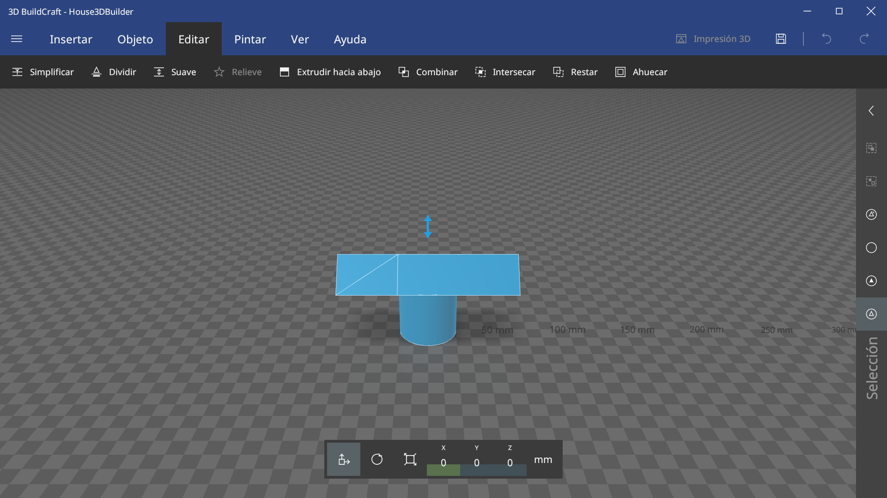

# 3D BuildCraft

Build, repair and prepare 3D models for printing. Runs on Windows, Linux and macOS, and looks like Microsoft 3D Builder: its own title bar, tabs, ribbon, tool bars, side menu, selection strip and bottom bar.



## Download

Each release on GitHub has a package per system:

- Windows: `buildcraft3d-windows-x64.zip`, unzip and run `buildcraft3d.exe`.
- macOS (Apple silicon and Intel, coming in a later release): `buildcraft3d-macos-universal.zip` with `3D BuildCraft.app`. It is not signed: the first time, right-click it and choose Open, or run `xattr -dr com.apple.quarantine "3D BuildCraft.app"`.
- Linux: `buildcraft3d-linux-x86_64.flatpak`, installed with `flatpak install --user buildcraft3d-linux-x86_64.flatpak` (it needs the GNOME 51 runtime from Flathub).

Packages are built by `.github/workflows/release.yml` when a `v*` tag is pushed.

## Run

```bash
cargo run --release -- [model.3mf|.stl|.obj|.ply|.gltf|.glb]
```

## Screenshots

The window can save itself as a PNG and quit, which is how the pictures in `docs/screenshots/` are made (the original's screenshots were at 1920×1080 and 150 %):

```bash
cargo run --release -- model.3mf --select-all --lang es --size 1920x1080 --zoom 1.5 --tab edit --screenshot shot.png
```

`--tab insert|object|edit|paint|view|help`, `--tool cut|simplify|hollow|emboss|measure|paint|paint-colors|paint-more|custom|camera|ai|chat|unsaved|repairing|grid|recover|start|bar-edit|add|print|print-material|print-design|print-about` `--mode move|rotate|scale` and `--menu` open a given state.

## Test

```bash
cargo test
```

Linux needs the usual windowing libraries (`libxkbcommon`, `wayland`, GTK 3 for file dialogs).

## What works

- Open and save 3MF, STL, OBJ (+MTL), PLY, glTF and GLB; drag files onto the window.
- Import asks for the file units when the format has none (STL, OBJ, PLY).
- Primitives: cube, cylinder, pyramid, cone, sphere, hexagon, wedge, torus, tetrahedron (40 mm), and Custom with subdivisions, size and roundness.
- Add dialog with recent files and local 3D libraries (folders you add, browsed by subfolder with search and thumbnails); Load image as a height relief or an outline; paint by area with Coverage (kept in 3MF); Camera (webcam photo into Load image); 3D print view (material, design with scale and size, about) whose Print opens the scene as 3MF in the chosen slicer (PrusaSlicer, OrcaSlicer, Bambu Studio, SuperSlicer or Cura, found automatically or picked by hand).
- Select (click, Ctrl/Shift for more), move by dragging, exact move/rotate/size from the bottom bar.
- Duplicate, copy, cut, paste, delete, put on floor, mirror, merge, measure distance, colours.
- Undo/redo, autosave with recovery after a crash, recent files, settings.
- View toggles: shading, colours, smoothing, wireframe, floor grid, x-ray.
- English and Spanish UI (follows the system language; change it in Settings).
- Meshes that are open or non-manifold are flagged with a red box and can be repaired.
- Booleans (merge, intersect, subtract), plane cut and simplify.
- Smooth, hollow (minimum wall thickness) and extrude down.
- Emboss text (bundled or system font), a shape or an image onto an object: planar, cylindrical or spherical projection, raised or engraved, bevel, separate top and side colours; drag it on the model to place it, Shift+drag to turn it.

Camera: left drag on empty space orbits, right or middle drag pans, wheel zooms.

## AI assistant

Menu → AI assistant turns it on and picks what it talks to: an installed agent (Claude Code or Codex, found on PATH), a command of your own, or a model endpoint (OpenAI-compatible such as Ollama, LM Studio, OpenAI or OpenRouter, or Anthropic-compatible). API keys go to the system keychain, never to the settings file. The chat opens from the button next to 3D print; the assistant works on the open scene with the app's tools (read the scene, select, insert shapes, move/rotate/size, booleans, repair, smooth, hollow, simplify, split, emboss text, colour, open, save, print, screenshot), each change shows as it happens and is an undo step.

The same tools are served over MCP for agents outside the app. Turn on "External agents (MCP)" and add the command to your agent, for example with Claude Code:

```bash
claude mcp add buildcraft3d -- /path/to/buildcraft3d --mcp
```

With the app open, `--mcp` attaches to that window through a local port (127.0.0.1, with a token in a file only you can read); otherwise it opens a window of its own.

## Not yet

Textures; slicing and sending to the printer from the app (the slicer does it for now).

Development notes (architecture, decisions, progress log and the study of the original app) are in [docs/dev](docs/dev/README.md).

## License

MIT. See [LICENSE](LICENSE). 3D BuildCraft is an independent project, not affiliated with or endorsed by Microsoft; "3D Builder" is a trademark of Microsoft.
