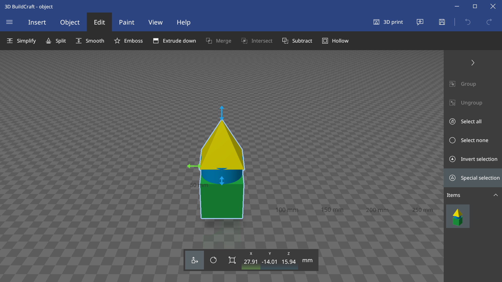
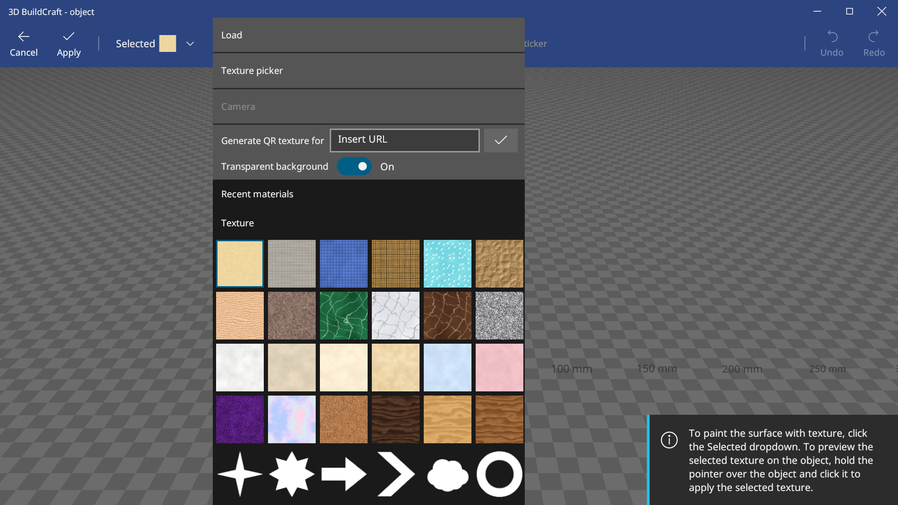
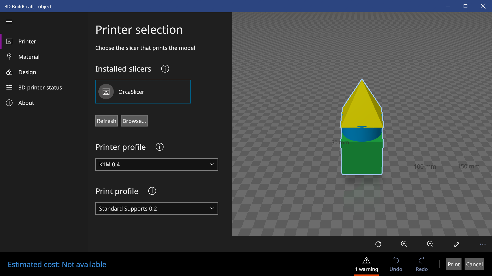
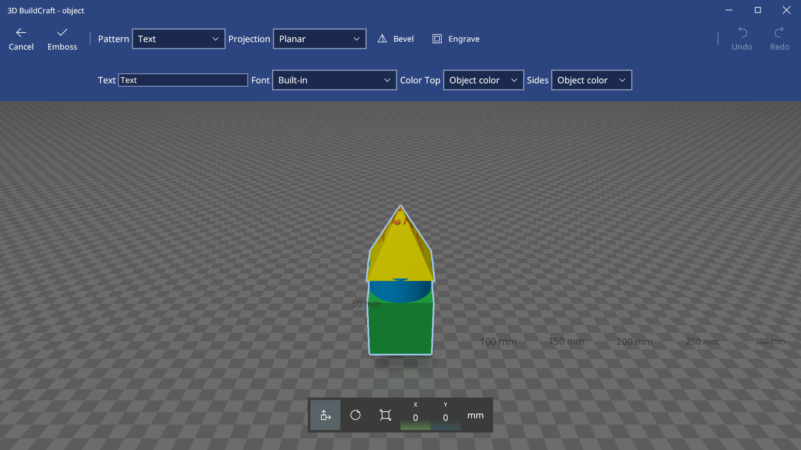
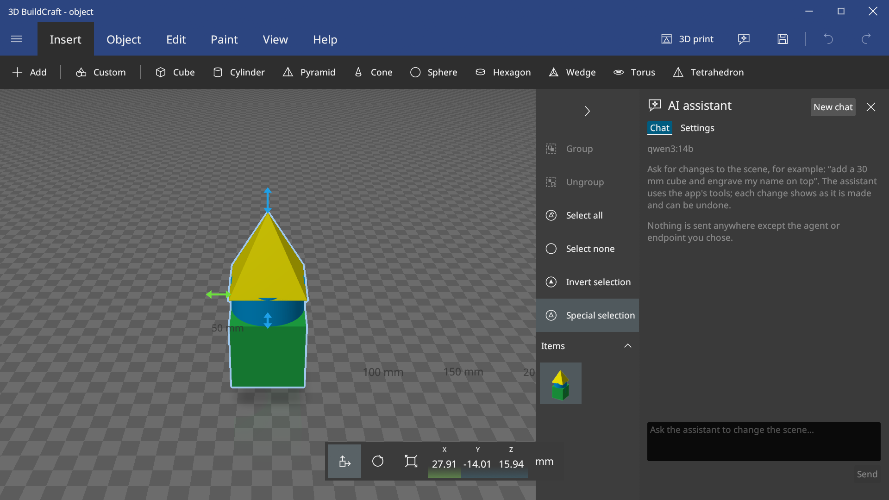

# 3D BuildCraft

Build, repair, paint and prepare 3D models for printing. A Rust (egui + wgpu) desktop app for Windows and Linux that looks and works like Microsoft 3D Builder: its own title bar, tabs, ribbon, tool bars, side menu, selection strip and bottom bar.



| | |
|---|---|
|  |  |
|  |  |

## Download

[Releases](https://github.com/Nico2433/3D-BuildCraft/releases) are pre-releases built from the `development` branch, with a package per system:

- **Windows:** `buildcraft3d-windows-x64.msi` is the installer. A newer version upgrades the existing installation; remove it through Settings > Apps. `buildcraft3d-windows-x64.zip` is the portable exe.
- **Linux, Flatpak:** `flatpak install --user buildcraft3d-linux-x86_64.flatpak` (needs the GNOME 51 runtime from Flathub).
- **Linux, AppImage:** `buildcraft3d-linux-x86_64.AppImage`, a single file for glibc 2.31 or newer (Ubuntu 20.04 and later). Make it executable with `chmod +x` and run it.

macOS builds are planned but not published yet.

## What it does

**Files**
- Open and save 3MF, STL, OBJ (+MTL), PLY, glTF and GLB; drag files onto the window. Unitless formats (STL, OBJ, PLY) ask for the units.
- Undo/redo, autosave with recovery after a crash, recent files, start screen.
- About the model: title, designer, copyright, license terms and description, kept in the 3MF metadata. The window title follows the model title.

**Building**
- Shapes: cube, cylinder, pyramid, cone, sphere, hexagon, wedge, torus, tetrahedron (40 mm), and Custom with subdivisions, size, roundness and a wireframe option.
- Add dialog: recent files as thumbnails, local 3D libraries (your own folders, browsed and searched with thumbnails), Load image as a height relief or an outline, Camera (a webcam photo).
- Select (click, Ctrl/Shift for more, box selection), move, rotate and scale with handles or exact values in the bottom bar. Objects snap to each other's edges and centres with alignment guides; hold Alt while dragging to turn snapping off.
- Duplicate, copy, cut, paste, delete, group, put on floor, mirror, measure distances.
- Booleans (merge, intersect, subtract), Split with a movable and rotatable cut plane, Simplify, Smooth, Hollow, Extrude down.
- Emboss text (bundled or installed font), a shape or an image onto an object: planar, cylindrical or spherical, raised or engraved, with bevel and separate top and side colours.
- Open or non-manifold meshes are flagged with a red box and can be repaired.

**Painting**
- Colour per object, or paint areas with a Coverage slider (kept in 3MF).
- Material: none, simple, realistic or translucent, standard colours and an eyedropper.
- Texture: 24 procedural textures and 6 stencils, your own pictures, camera frames and QR codes; place them as stickers or paint them with a brush.

**Printing**
- 3D print: detects installed slicers (OrcaSlicer, PrusaSlicer, Bambu Studio, SuperSlicer, Cura, also as Flatpaks) or one you pick. Choose the slicer's printer and print profile, map each scene colour to a filament slot, set the size, then Print opens the scene as a 3MF in the slicer with those choices.
- 3D printer status: the printers set up in the slicer with state, progress, file and temperatures, refreshed every 5 s (Klipper/Moonraker printers).
- Print on paper through the system's own print dialog (the desktop portal on Linux, Flatpak included).

**Interface**
- View toggles: shading, colours, smoothing, wireframe, floor grid, x-ray.
- English and Spanish (follows the system language; change it in Settings).
- Camera: left drag on empty space orbits, right or middle drag pans, wheel zooms.

## AI assistant

The assistant button in the top bar opens a chat with Chat and Settings tabs. Settings turns the assistant on and picks what it talks to: an installed agent (Claude Code or Codex, found on PATH), a command of your own, or a model endpoint (OpenAI-compatible such as Ollama, LM Studio, OpenAI or OpenRouter, or Anthropic-compatible). API keys go to the system keychain, never to the settings file.

The assistant works on the open scene with the app's tools (read the scene, select, insert shapes (sized or as Custom), move/rotate/size, booleans, repair, smooth, hollow, simplify, split with a level or slanted plane, emboss text, shapes or pictures, colour, paint an area, materials, textures and stickers, add a file, load an image, open, save, print, screenshot). Each change shows as it happens and is an undo step.

The same tools are served over MCP for agents outside the app. Turn on "External agents (MCP)" and add the command to your agent, for example with Claude Code:

```bash
claude mcp add buildcraft3d -- /path/to/buildcraft3d --mcp
```

With the app open, `--mcp` attaches to that window through a local port (127.0.0.1, with a token in a file only you can read); otherwise it opens a window of its own.

## Not yet

- Slicing and sending jobs to the printer from the app; the slicer does it.
- Printer status reads Moonraker only (OctoPrint, PrusaLink and stock firmware show as offline).
- Textures are not saved in files: tiled faces are saved with the texture's average colour, stickers are dropped.
- Print on paper on Windows is untested; no macOS packages yet.

## Build and run

```bash
cargo run --release -- [model.3mf|.stl|.obj|.ply|.gltf|.glb]
```

```bash
cargo test
```

Linux needs the usual windowing libraries (`libxkbcommon`, `wayland`, GTK 3 for file dialogs).

Packages are built locally with the scripts in `packaging/`:

- `packaging/windows/build-msi.sh`: Windows exe and MSI from Linux (cargo-zigbuild, zig, Python 3, msitools/wixl).
- `packaging/flatpak/io.github.nico2433.BuildCraft3D.yml`: Flatpak manifest for `flatpak-builder`.
- `packaging/appimage/build-appimage.sh`: AppImage linked against glibc 2.31 (cargo-zigbuild, zig, appimagetool).

## Screenshots

The window can save itself as a PNG and quit, which is how the pictures in `docs/screenshots/` are made:

```bash
cargo run --release -- model.3mf --select-all --lang en --size 1920x1080 --zoom 1.5 --tab edit --screenshot shot.png
```

Options that open a given state:

- `--tab insert|object|edit|paint|view|help`, `--mode move|rotate|scale`, `--menu`, `--select-all`
- `--tool` with a tool: `add`, `custom`, `camera`, `cut`, `simplify`, `smooth`, `hollow`, `emboss`, `measure`, `settle`, `paint`, `paint-colors`, `paint-more`, `material`, `material-type`, `texture`, `texture-menu`, `texture-sticker`, `texture-edit`, `texture-brush`
- `--tool` with a page or dialog: `print-printer`, `print-material`, `print-design`, `print-status`, `print-about`, `settings`, `about`, `ai`, `chat`, `unsaved`, `recover`, `repairing`, `grid`, `bar-edit`
- `--image <file>` opens Load image, `--library <folder>` a 3D library

Development notes (architecture, decisions, progress log and the study of the original app) are in [docs/dev](docs/dev/README.md).

## License

MIT. See [LICENSE](LICENSE). 3D BuildCraft is an independent project, not affiliated with or endorsed by Microsoft; "3D Builder" is a trademark of Microsoft.
